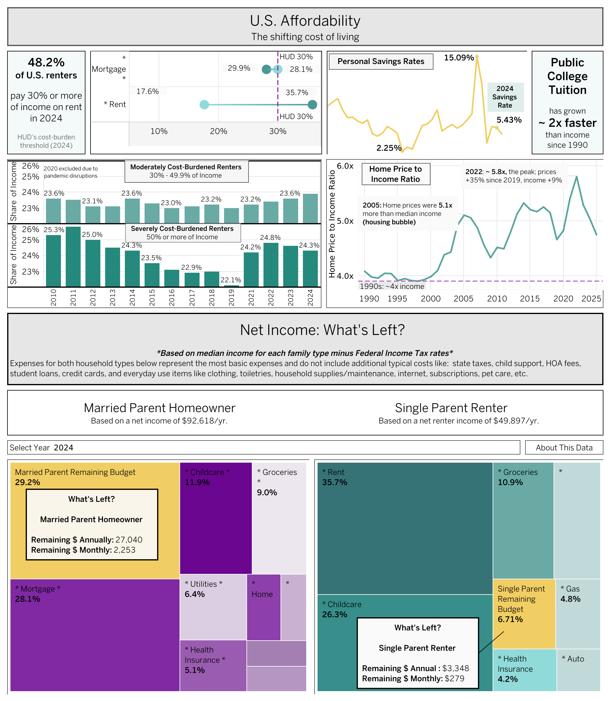

# U.S. Affordability: How the Cost of Living Has Shifted, 1990–2025

**How have housing, rent, education, childcare, and everyday costs changed relative to what American households earn?**

A 36-year dataset (1990–2025, 62 variables) built from Census, BLS, FRED, Freddie Mac, NCES, and Department of Labor data, with an interactive Tableau dashboard.

**[View the interactive dashboard on Tableau Public](https://public.tableau.com/app/profile/jessica.kiesel/viz/U_S_Affordability/U_S_Affordability)**



---

## Key Findings

All figures compare costs and incomes in the same year's dollars.

1. **Homes cost more years of income.** The median new home cost **4.1× median household income in 1990** and **4.75× in 2025**, after peaking at **5.8× in 2022**.
2. **Rent's share of income rose by more than a third.** Median asking rent went from **14.9% of median income in 1990 to 20.5% in 2025**. In 2024, **48% of renter households** paid 30% or more of their income on rent, and **24%** paid half or more.
3. **Mortgage payments swing with interest rates.** An estimated payment on the median new home took **34.8% of median income in 1990** (rates near 10%), fell to a low of **19.8% in 2020**, and jumped back to **33.1% in 2023**.
4. **College costs outpaced everything.** Public in-state tuition rose **6.3×** since 1990, compared with **2.9×** for median income and **2.5×** for overall prices (CPI).
5. **The federal minimum wage lost ground.** Full-time minimum-wage pay equaled **26% of median household income in 1990** and **17% in 2025**. It hasn't changed since 2009.
6. **Not everything got harder.** Groceries and gasoline take a slightly *smaller* share of median income than in 1990 (groceries 8.3% → 7.5%, gas 3.5% → 2.9%, 1990 vs. 2024).

## A correction, and why it matters

An earlier version of this dataset stored incomes in **inflation-adjusted 2025 dollars** but costs in **each year's actual dollars**, then divided one by the other. That made the past look far more affordable than it was. For example, 1990 rent showed as **6.6%** of income instead of **14.9%**.

`scripts/fix_dollar_basis.py` puts every income column on the same basis as the costs. It uses the current-dollar figures Census publishes alongside its inflation-adjusted ones (Tables H-5 and F-7), reverses the CPI adjustment the pipeline applied to ACS incomes, rescales each "% of income" column by its own denominator, and checks every result against an independent recalculation. All dollar columns are now nominal; `CPI_Index` converts any of them to constant dollars.

## Data

| File | Contents |
|---|---|
| `data/affordability_merged.csv` / `.xlsx` | Final dataset: 36 years × 62 columns (the `.xlsx` feeds the Tableau workbook) |
| `data/raw/` | Original downloads from each source |
| [`DATA_DICTIONARY.md`](DATA_DICTIONARY.md) | Every column: definition, formula, source, coverage |
| [`SOURCES.md`](SOURCES.md) | Source list with links |

## Methods

- **Income** comes from Census Tables H-5 (median and mean household) and F-7 (married-couple families), with ACS Table B25119 for owner and renter households (2010–2024).
- **After-tax income** applies each year's actual federal brackets and standard deduction for married-filing-jointly and single filers. It covers federal income tax only.
- **Costs** come from the BLS Consumer Expenditure Survey (household spending), FRED (home prices, gas, CPI, savings), Freddie Mac (mortgage rates), the Census Housing Vacancy Survey (rent), NCES and College Board (tuition), and Child Care Aware of America (childcare).
- **Derived metrics** include estimated mortgage payments and lifetime interest (20% down, 30-year fixed), cost-to-income ratios on gross and after-tax income, and renter cost-burden shares from ACS Table B25070.
- **Two household personas** on the dashboard, a married parent homeowner and a single parent renter, use BLS spending figures for those household types and tenure-matched ACS incomes to estimate what's left after basic costs in 2024.

## Limitations

- Home prices are for **new** homes only; rent is **asking** rent for vacant units.
- After-tax income excludes state, local, and payroll taxes, as well as credits and exemptions.
- Household-type spending figures are from 2022, held flat through 2025.
- Income sources switch between Census CPS and ACS series for some columns, creating breaks in 2010, 2020, and 2025.
- Childcare data covers 2022–2025 only; no consistent national series exists further back.
- Tuition switches source between 2023 and 2024.

## Repository Structure

```
us-affordability/
├── README.md
├── DATA_DICTIONARY.md
├── SOURCES.md
├── data/
│   ├── affordability_merged.csv
│   ├── affordability_merged.xlsx
│   └── raw/                    # source downloads
├── scripts/
│   ├── merge_data.py           # builds the dataset from data/raw
│   └── fix_dollar_basis.py     # puts incomes on the same dollar basis as costs
├── tableau/
│   └── U.S. Affordability.twbx
└── images/
    └── dashboard.png
```

## How to Reproduce

The scripts read from and write to the working directory:

```
cd data/raw
python3 ../../scripts/merge_data.py        # writes affordability_merged.csv
```

The published dataset also includes household-type and renter-income columns added after the main merge. Those steps are noted in `merge_data.py`. `fix_dollar_basis.py` was then run once on the final file and refuses to run twice.

Requires Python 3 with `pandas` and `openpyxl`.

## Author

**Jessica Kiesel**, M.S. Data Analytics · [GitHub](https://github.com/jkiesel-insights)
